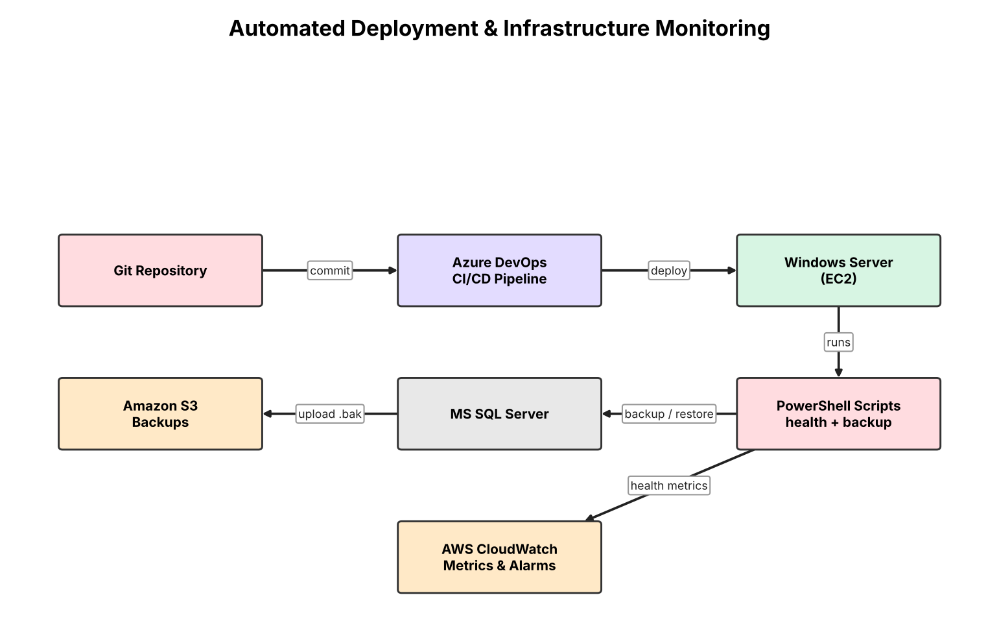

# Automated Deployment & Infrastructure Monitoring

> CI/CD, health checks and database backups

## Problem
Manual deployments, server checks and database backups are repetitive and error-prone.

## What I Built
- Azure DevOps CI/CD pipeline
- CloudWatch monitoring for EC2 / Windows Server
- PowerShell health checks
- MS SQL Server backup and restore with S3 storage

## Tech Stack
AWS (EC2, S3, CloudWatch), Azure DevOps, Windows Server, PowerShell, MS SQL Server, Git

## Result
Automated deployments and server health checks, with SQL Server backups stored in Amazon S3.

## Documentation
- [Architecture Flow](docs/architecture.md)
- [Workflow](docs/workflow.md)
- [Improvements](docs/improvements.md)

