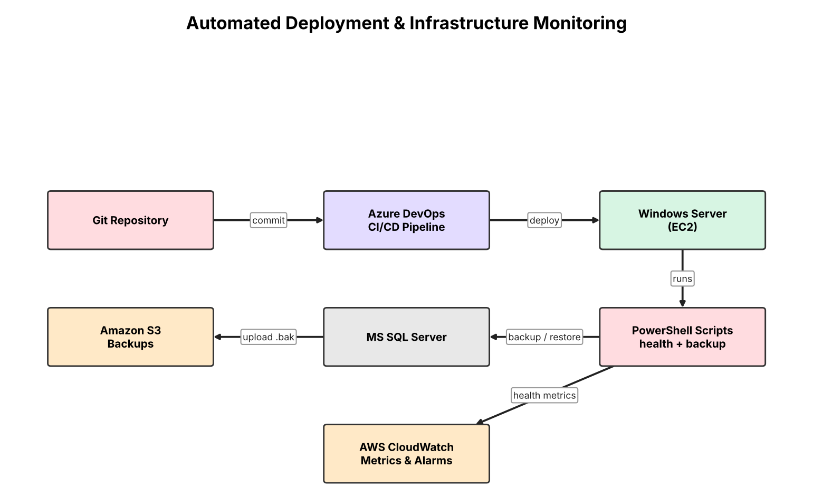
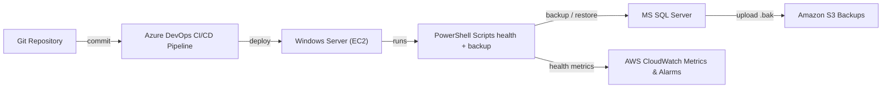

# Architecture Flow - Automated Deployment & Infrastructure Monitoring

## Diagram (Mermaid - renders on GitHub)

## Components
- **Git Repository**
- **Azure DevOps CI/CD Pipeline**
- **Windows Server (EC2)**
- **PowerShell Scripts health + backup**
- **MS SQL Server**
- **Amazon S3 Backups**
- **AWS CloudWatch Metrics & Alarms**

## Tech Stack
AWS (EC2, S3, CloudWatch), Azure DevOps, Windows Server, PowerShell, MS SQL Server, Git
