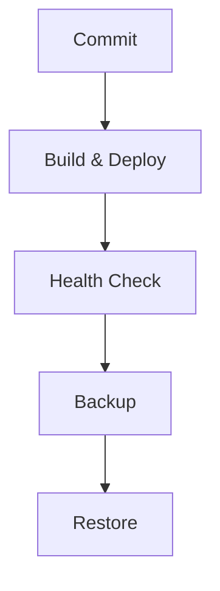

# Workflow - Automated Deployment & Infrastructure Monitoring

## Step-by-step flow

1. **Commit** - Developer pushes code to Git.
2. **Build & Deploy** - Azure DevOps builds and releases to the Windows Server on EC2 automatically.
3. **Health Check** - A scheduled PowerShell script checks CPU, memory, disk, IIS/services and reports to CloudWatch.
4. **Backup** - PowerShell runs a SQL Server full/differential backup and uploads the .bak file to S3.
5. **Restore** - When needed, the latest backup is pulled from S3 and restored using a PowerShell restore script.

## Sequence (Mermaid)

