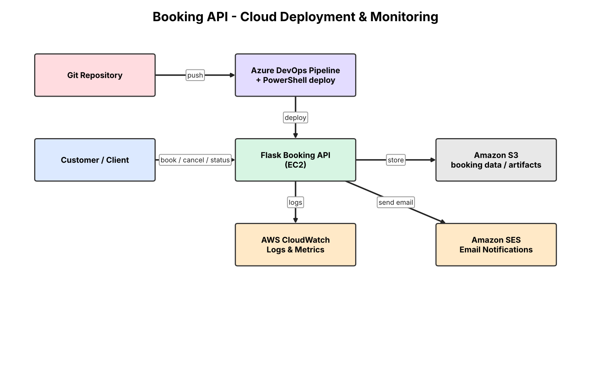

# Booking API - Cloud Deployment & Monitoring

> Booking service deployed and monitored on AWS

## Problem
Booking systems need reliable deployments, visibility into failures, and customer notifications.

## What I Built
- Flask REST APIs for booking creation, cancellation and status tracking
- Deployed on AWS EC2
- CloudWatch monitoring for logs and metrics
- Amazon SES email notifications to customers
- S3 for artifacts / booking data storage
- Azure DevOps CI/CD with Git and PowerShell scripts

## Tech Stack
Python, Flask, AWS EC2, S3, CloudWatch, SES, Azure DevOps, Git, PowerShell

## Result
Automated deployment through Azure DevOps CI/CD and Git, with monitoring and email notifications in place.

## API Endpoints (sample)

- `POST /bookings - create booking`
- `GET /bookings/{id} - booking status`
- `DELETE /bookings/{id} - cancel booking`
- `GET /health - health check`

## Documentation
- [Architecture Flow](docs/architecture.md)
- [Workflow](docs/workflow.md)
- [Improvements](docs/improvements.md)

