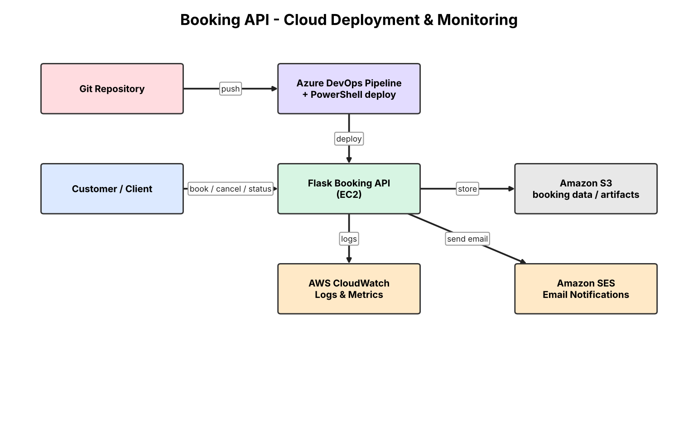
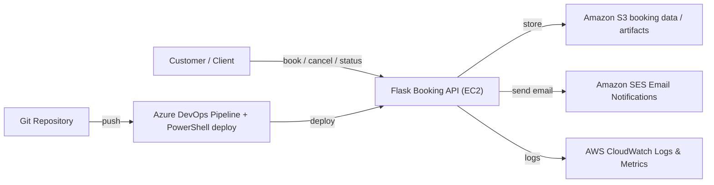

# Architecture Flow - Booking API - Cloud Deployment & Monitoring

## Diagram (Mermaid - renders on GitHub)

## Components
- **Customer / Client**
- **Flask Booking API (EC2)**
- **Amazon S3 booking data / artifacts**
- **Amazon SES Email Notifications**
- **AWS CloudWatch Logs & Metrics**
- **Git Repository**
- **Azure DevOps Pipeline + PowerShell deploy**

## Tech Stack
Python, Flask, AWS EC2, S3, CloudWatch, SES, Azure DevOps, Git, PowerShell
