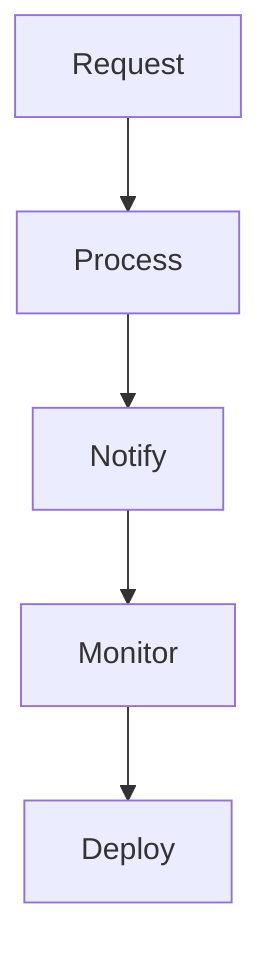

# Workflow - Booking API - Cloud Deployment & Monitoring

## Step-by-step flow

1. **Request** - Customer calls the Flask API to create, cancel or check a booking.
2. **Process** - The API validates input, saves the booking and updates its status (CONFIRMED / CANCELLED).
3. **Notify** - SES sends a confirmation or cancellation email to the customer.
4. **Monitor** - Application logs and EC2 metrics go to CloudWatch; failures can trigger alarms.
5. **Deploy** - Git push triggers Azure DevOps: build, package, PowerShell deployment to EC2, health check.

## Sequence (Mermaid)

