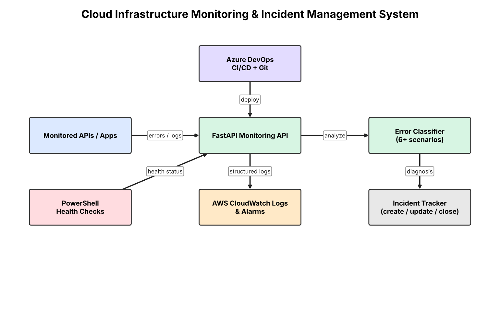

# Cloud Infrastructure Monitoring & Incident Management System

> Monitors APIs and diagnoses incidents automatically

## Problem
Application errors and infrastructure incidents are slow to spot and classify by hand.

## What I Built
- FastAPI APIs to monitor errors and track incidents
- CloudWatch logging for application and server events
- PowerShell server health checks (CPU, memory, disk, service status)
- Azure DevOps CI/CD deployment

## Tech Stack
Python, FastAPI, AWS CloudWatch, Azure DevOps, Git, PowerShell

## Result
Automated incident diagnostics for 6+ error scenarios.

## API Endpoints (sample)

- `POST /errors - report an application error`
- `GET /incidents - list incidents`
- `GET /incidents/{id} - incident details`
- `PATCH /incidents/{id} - update status`
- `GET /health - service health`

## Documentation
- [Architecture Flow](docs/architecture.md)
- [Workflow](docs/workflow.md)
- [Improvements](docs/improvements.md)

