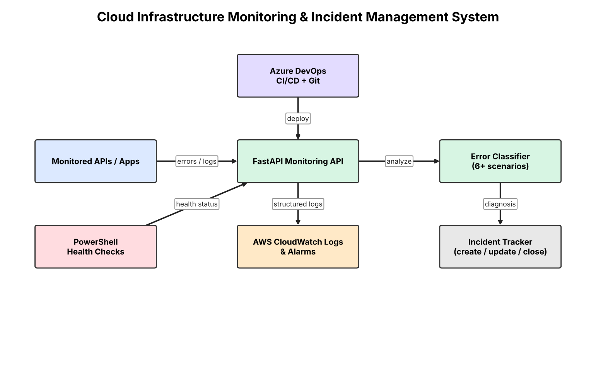
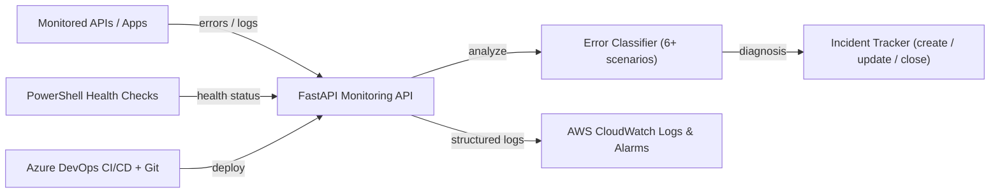

# Architecture Flow - Cloud Infrastructure Monitoring & Incident Management System

## Diagram (Mermaid - renders on GitHub)

## Components
- **Monitored APIs / Apps**
- **FastAPI Monitoring API**
- **Error Classifier (6+ scenarios)**
- **Incident Tracker (create / update / close)**
- **AWS CloudWatch Logs & Alarms**
- **PowerShell Health Checks**
- **Azure DevOps CI/CD + Git**

## Tech Stack
Python, FastAPI, AWS CloudWatch, Azure DevOps, Git, PowerShell
