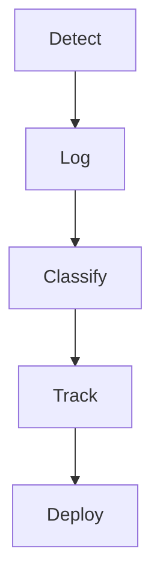

# Workflow - Cloud Infrastructure Monitoring & Incident Management System

## Step-by-step flow

1. **Detect** - Application errors and server metrics arrive at the FastAPI monitoring endpoints; PowerShell scripts push server health status on a schedule.
2. **Log** - Every event is written to AWS CloudWatch Logs with severity, service name and timestamp.
3. **Classify** - The classifier matches error patterns against 6+ known scenarios (e.g. timeout, 5xx spike, DB connection failure, high CPU, disk full, service down).
4. **Track** - An incident record is created with status, severity, probable cause and suggested fix; later events update the same incident.
5. **Deploy** - Code pushed to Git triggers the Azure DevOps pipeline: build, test, deploy to the server, smoke test.

## Sequence (Mermaid)

